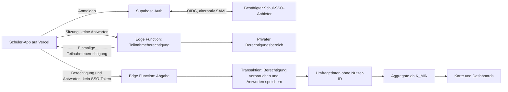

# Schüler-Anmeldung über bestehendes Schul-SSO

**Stand: 21.10.2026 · Vorschlag in #74, noch keine Architekturfreigabe.**
Yanic möchte die Anmeldung mit vorhandenen Schülerkonten einplanen. Der Anbietername ist noch offen (im Chat erfragt). Dieser Entwurf ergänzt die Planung; ADR-003/005, der Mock-Modus und das bestehende `DataSource`-Interface gelten weiter. Es werden noch keine echten Schülerkonten angebunden.

## 1. Anschlussweg und offene Entscheidung

| Situation | Vorgeschlagener Anschluss | Vor Umsetzung nachweisen |
|---|---|---|
| Anbieter unterstützt OIDC | Eigener OIDC-Provider in Supabase Auth; bestehendes Schulportal bleibt Kontoquelle | Discovery, Test-Client, Claims, Freischaltung der Schulen |
| VIDIS ist der gemeinte Dienst | Moodmap als Bildungsangebot an dessen Testsystem anbinden | Anbieteraufnahme, unterstützte Landes-/Schulportale und konkrete Pilotschulen |
| Anbieter liefert nur SAML | Supabase-Projekt-SSO prüfen | Metadaten, Attributzuordnung, Tarif und Abmeldeverhalten |

**Geprüfte Grundlagen:** VIDIS beschreibt OIDC für Diensteanbieter sowie `sub`, `schulkennung` (mehrwertig) und `rolle`; die Beispielrollen sind `LERN`, `LEHR`, `LEIT`. Das macht VIDIS zu einem Kandidaten, bestätigt aber weder den von Yanic gemeinten Anbieter noch flächendeckende Konten/Freischaltungen. Das verlinkte Whitepaper trägt Version 60, Export 13.08.2024; das aktuelle Anschlussprofil muss der Anbieter bestätigen. [VIDIS-Whitepaper](https://www.vidis.schule/Whitepaper-Service-Provider), [Teilnahmeprozess](https://www.vidis.schule/teilnahmeprozess/).

Supabase dokumentiert benutzerdefinierte OIDC-Provider mit Discovery, JWKS-Prüfung, standardmäßig aktiviertem PKCE und optionaler E-Mail (`email_optional`). Damit ist zunächst kein zusätzlicher Identity-Broker vorgesehen. Der alternative SAML-Anschluss ist laut Dokumentation ab Pro verfügbar; Single Logout wird dort nicht unterstützt. Verfügbarkeit und Konfiguration am konkreten Projekt bleiben zu prüfen. [OIDC-Anbindung](https://supabase.com/docs/guides/auth/custom-oauth-providers), [Projekt-SAML](https://supabase.com/docs/guides/auth/enterprise-sso/auth-sso-saml).

Keine Schulpasswörter in Moodmap eingeben oder speichern. Keine Annahme, dass eine Schul-E-Mail als Berechtigungsnachweis reicht.

## 2. Zielbild im bestehenden Stack

Die eingezeichneten Endpunkte sind geplante Verantwortlichkeiten, keine bereits vorhandenen APIs. Vercel liefert die SPA; Authentifizierung, Prüfungen und Schreibrechte liegen serverseitig. `service_role`, Client-Secret und HMAC-Schlüssel gelangen nicht ins Frontend.

### Anmeldung und Schulzuordnung

1. `/login` startet den Code-Flow. Der Protokoll-Client prüft Signaturen, erlaubten Issuer, Audience, Ablauf, State und bei OIDC Nonce/PKCE; keine selbst gebaute Tokenprüfung.
2. Der Anbieter-Callback landet am registrierten Auth-Endpunkt; anschließend führt ein erlaubter App-Redirect nach `/auth/callback`. Dort wird nur die App-Sitzung abgeschlossen. `returnTo` darf ausschließlich auf erlaubte relative App-Routen zeigen.
3. Eine serverseitige Anbindung übernimmt verifizierte Anbieter-Claims. Die genaue Callback-/Hook-Integration und Claim-Verfügbarkeit sind im Testsystem nachzuweisen. Browserdaten und veränderbare `user_metadata` sind keine Quelle für Berechtigungen.
4. Ein privates Mapping `(issuer, externe Schulkennung) → school_id` ordnet ausschließlich freigeschaltete Schulen zu. Keine Ableitung allein aus Schulnamen, E-Mail-Domains oder dem QR-Code.
5. Bei mehreren verifizierten Schulzugehörigkeiten wählt die Person eine davon. Fehlende/unbekannte Schule oder Rolle führt zu einer verständlichen Fehlermeldung; keine automatische Demo-Zuordnung im Echtbetrieb.

`/s/:code` bleibt ein Einstiegshinweis. Im SSO-Modus muss die Schule zur verifizierten Zugehörigkeit passen. Der Code überschreibt keine Claims. Der heutige Demo-Pfad bleibt separat funktionsfähig.

### Rollen und Sitzungen

- `LERN` berechtigt im vorgeschlagenen VIDIS-Mapping zur Schülerumfrage. Andere Anbieter benötigen ein explizites Mapping. Fehlende/unbekannte Werte geben keine Rechte.
- Lehrkräfte und Schulleitung erhalten nicht automatisch Verwaltungsrechte. Schul-Dashboard und Ministerium benötigen zusätzliche serverseitige Freigaben; das Ministerium erhält keine Rechte aus einem Schüler-SSO.
- Der Rollen-Umschalter aus #30 gilt ausschließlich für synthetische Demonstrationen. Im Echtbetrieb erzwingen Funktionen/RLS die Zugriffe, auch bei direkten HTTP-Anfragen.
- Logout beendet die Moodmap-Sitzung und entfernt lokale Sitzungsdaten/Entwürfe. Anbieterweiter Logout wird nur nach erfolgreichem Integrationstest zugesagt. Auf geteilten Geräten muss die App klar anzeigen, ob die Sitzung beendet ist.

## 3. Identität, Doppelteilnahme und Antwortdaten trennen

**Anmeldung verarbeitet Identitätsdaten, auch wenn eine Kennung pseudonym ist.** Die bisherigen Aussagen „kein Account“ und „100 % anonym“ dürfen nicht unverändert auf einen SSO-Echtbetrieb übertragen werden. Vor Umsetzung braucht es eine ausdrückliche Datenschutz-/Architekturfreigabe; die bestehenden Leitplanken werden hier nicht abgeschwächt.

Vorgeschlagene Datenbereiche:

| Bereich | Minimaler Inhalt | Zugriff / Ausschluss |
|---|---|---|
| Auth | Anbieterbindung und kurzlebige Sitzungen | Keine Antworten; Namen, E-Mail, Klassen und weitere Profilattribute nicht anfordern; tatsächliche Auth-Speicherung vor Freigabe prüfen |
| Berechtigung | Verifizierte Schulzugehörigkeit, Rolle und Welle; Ausgaberegister | Privat, kein `anon`-/Client-SELECT; keine Antwort-ID |
| Einlösung | Digest der zufälligen Einmalberechtigung, Schule, Rolle, Welle, Ablauf und Verbrauch | Kein `sub`, keine Auth-Nutzer-ID; keine Antwort-ID |
| Umfrage | Zufällige Response-ID, Schule, Welle, optionale grobe Stufe, Antworten, gerundeter Tag | Keine SSO-ID, `auth.uid()`, E-Mail, Berechtigungs-ID oder Berechtigungs-Digest |
| Auswertung | Geschützte Aggregate | K_MIN und Rollengrenzen auch für angemeldete Personen |

**Doppelteilnahme:** Ein serverseitiger, wellengebundener Schlüssel, etwa `HMAC(K_welle, issuer || sub || wave)`, begrenzt die Ausgabe auf eine Berechtigung pro Person und Welle. Kodierung muss eindeutig sein; der Schlüssel bleibt im Berechtigungsbereich. Eine andere Schule oder ein anderes Gerät erlaubt keine zweite Ausgabe. Diese Regel setzt stabile, anbieterseitig eindeutig zugeordnete Kennungen voraus; mehrere getrennte Konten derselben Person löst sie nicht.

**Abbruch und Wiederaufnahme:** Ausgabe und tatsächliche Abgabe sind getrennte Zustände. Derselbe berechtigte Nutzer erhält vor der Einlösung seine noch gültige Berechtigung erneut; dafür wäre ausschließlich im privaten Ausgaberegister eine verschlüsselte Wiederherstellung nötig. Keine zweite unabhängig gültige Berechtigung ausstellen. Abgelaufene, ungenutzte Berechtigungen dürfen nur atomar widerrufen und ersetzt werden.

**Abgabe:** Der Abgabe-Endpunkt bekommt keinen SSO-Bearer und keine Identitäts-Claims. Eine Datenbanktransaktion prüft Schule/Welle/Rolle/Ablauf, markiert die Berechtigung einmalig als verbraucht und speichert die Antworten ohne Rückverweis. Konkurrenz und Retries dürfen keine zweite Antwort erzeugen. Bei Rollback bleibt eine erneute Abgabe möglich; nach erfolgreicher Einlösung liefert ein Retry nur eine generische Bestätigung, keine Antwortdaten. Direkte Inserts auf Rohdatentabellen bleiben gesperrt.

**Grenze dieser Trennung:** Der Ausgabedienst kennt Person und Berechtigung. Gemeinsame Administratoren, Ausgaberegister und zeitlich korrelierbare Logs können eine Zuordnung ermöglichen. Das ist keine bewiesene kryptografische Unverknüpfbarkeit. Vor einem echten Pilotbetrieb muss ein geprüftes Verfahren diese Grenze mit den Datenschutz-Leitplanken vereinbaren; falls stärkere Anonymität gefordert ist, ist ein fachlich geprüftes Verfahren mit verdeckter Berechtigungsausgabe nötig. Keine eigene Kryptografie erfinden. Bis zur Freigabe nur synthetische Testidentitäten verwenden.

## 4. Deployment und Betrieb

| Umgebung | Anmeldung | Daten / Konfiguration |
|---|---|---|
| Lokal und normale PR-Preview | Mock ohne Anbieterabhängigkeit | Synthetische Schulen/Antworten; keine produktiven Sessions oder Secrets |
| SSO-Staging auf fester Domain | Anbieter-Testmandant/Testkonten | Eigenes Supabase-Projekt, exakte Callback-/Logout-URLs |
| Produktion nach Freigabe | Freigeschalteter Anbieter-Client | Separates Projekt/Secrets, bestätigte Schulen und geprüfte Zugriffsregeln |

Geplante öffentliche App-Konfiguration: `VITE_AUTH_MODE=demo|school-sso` (Default `demo`) sowie eine öffentliche Provider-ID. Sie ist noch nicht implementiert. `VITE_DATA_MODE` bleibt unabhängig; echte SSO-Anmeldung mit Mock-Daten ist nur im klar markierten Testsystem zulässig. Eine ausgefallene echte Anmeldung fällt niemals still auf eine anonyme Abgabe zurück.

Issuer/Client-ID und erlaubte URLs gehören in die serverseitige Providerkonfiguration; Client-Secret, Service-Schlüssel und Wellen-HMAC-Schlüssel ausschließlich in den Secret-Store. Keine produktiven Redirect-Wildcards für beliebige PR-Domains. Keine Antwortentwürfe oder Tokens in URLs, Analytics, Request-Logs, Fehlerberichten oder Service-Worker-Caches. Infrastruktur-/Auth-Logs, Backups, Löschfristen und Administrationszugriffe sind Teil der Freigabe, nicht durch das Datenbankschema erledigt. Ausgabesperren dürfen während einer offenen Welle nicht vorzeitig gelöscht werden.

## 5. Umsetzung in kleinen Schritten

| Schritt | Ergebnis / Abnahme | Anschluss |
|---|---|---|
| A · Anbieter und Datenschutz klären | Anbietername, Pilotschulen, Protokoll/Claims, Testzugang, Speicher-/Löschkonzept und Trennungsverfahren bestätigt | Menschen + Lead; aus #74 konkrete Folge-Issues ableiten |
| B · Synthetischer Login-Spike | Test-Login/Logout, Claim-Prüfung, Schul-Mapping, abgewiesene Fremdrollen, getrennte Staging-Konfiguration | Ergänzt #22/#23; kein Umbau des Mock-Durchstichs |
| C · Berechtigungs- und Abgabeweg | Transaktionale Einmaligkeit, Wiederaufnahme und kein Identitätsschlüssel in Antworten nachgewiesen | Eigene Migrationen/RPCs nach Review; `device_hash` des Demo-Pfads nicht mit SSO-IDs befüllen |
| D · UX und Rechte | Verständlicher Schul-Login, Schulkonflikte, Session-Ablauf, eigenes Schulaggregat, geschützte Dashboards | #11/#12/#30; UI-Freigabe ist keine Backend-Freigabe |
| E · Begrenzter Pilot | End-to-End auf Test-/Pilotgeräten, Anbieter-/Datenschutzfreigabe und Betriebsverantwortung | Erst danach echte Konten/Antworten |

Abnahmetests für B–E: manipulierte/abgelaufene Tokens und falscher Issuer/Audience; fehlende Schule/Rolle; fremder QR-Code; Mehrschulzuordnung; kein Rollenaufstieg durch Browser- oder Metadatenänderung; parallele Abgaben und Netzwerk-Retry; Formularabbruch und Wiederaufnahme; Sitzungsablauf/Logout auf geteiltem Gerät; ungültige Redirects; kein Auth-/Antwortinhalt in Logs/Caches; RLS gegen rohe Antworten; K_MIN nach Filtern; unverändert funktionierende Demo ohne Anbieter/Keys. Claims nur mit synthetischen Fixtures testen.

## 6. Noch von Anbieter, Menschen und Lead zu beantworten

- Welcher Anbieter ist gemeint, welche Schulen sind angeschlossen und ist Moodmap dort freischaltbar?
- Gibt es einen Testmandanten, OIDC-Discovery oder SAML-Metadaten und bestätigte Callback-/Logout-Vorgaben?
- Welche minimalen Claims werden tatsächlich geliefert; sind Kennungen pro Angebot stabil und welche Mehrschul-/Kontowechselfälle gibt es?
- Kann die Übertragung/Speicherung von Namen, E-Mail, Klassen und anderen unnötigen Attributen vollständig ausgeschlossen werden?
- Wer betreibt die Identitäts-/Berechtigungsbereiche, wie werden Zugriffe/Logs/Backups getrennt und wann wird gelöscht?
- Welches geprüfte Verfahren erfüllt den geforderten Schutz vor Zuordnung von Identität zu Antworten? Wer gibt Pilotbetrieb, Rollen und Datenschutztexte frei?
